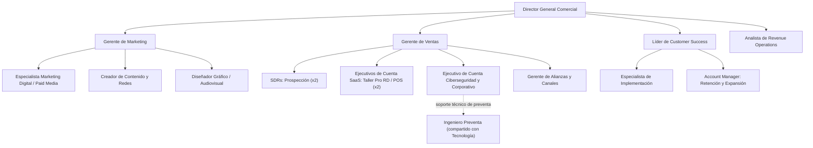

# Organigrama del Departamento Comercial



## Modelo de trabajo: embudo compartido

```
Marketing ──MQL──▶ SDR ──SQL──▶ Ejecutivo de Cuenta ──Cliente──▶ Customer Success
   ▲                                                                  │
   └───────────────── referidos, casos de éxito, expansión ◀──────────┘
                     (Revenue Ops mide todo el recorrido)
```

## Tamaño del equipo por fase

| Fase | Personas | Roles |
|---|---|---|
| **Fase 1** (Q1) | 5 | Director, Gerente de Ventas (player-coach), 2 SDR, 1 Marketing Digital |
| **Fase 2** (Q2) | 9 | + 2 AE SaaS, 1 Creador de Contenido, 1 Especialista de Implementación |
| **Fase 3** (Q3) | 13 | + Gerente de Marketing, AE Ciberseguridad, Alianzas, RevOps |
| **Fase 4** (Q4) | 16 | + Diseñador, Account Manager, Líder de CS |

Detalle de cada contratación en [`plan-de-contratacion.md`](plan-de-contratacion.md).
